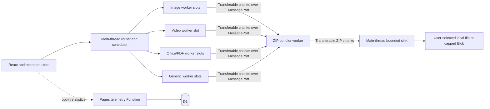

# BebiSmash — Master Engineering Blueprint & Multi-Agent Execution Plan

Status: implementation contract, 2026-10-16. Input: [foundation.md](foundation.md). This blueprint governs implementation when the concept document leaves choices open or makes unsupported guarantees. [DOCS.md](DOCS.md) is the onboarding guide; [AGENTS.md](../AGENTS.md) is the standalone contributor contract.

Telemetry/offline update: [ADR 0005](adr/0005-local-first-statistics-and-offline-assets.md) supersedes the v1 client write strategy and 30-second cached statistics reads below. New clients make one stats attempt per document, aggregate consented foreground writes per completed batch, and prepare offline application assets only by explicit action. Legacy API/schema compatibility remains during rollout; files never enter persistent storage.

The repository currently contains the concept and these planning documents. Code blocks below are implementation templates, not installed or runtime-verified application files. Infrastructure identifiers must be provisioned before deployment. Commands named here are the required future package-script contract.

Single-file delivery update: [ADR 0004](adr/0004-direct-single-file-output.md) supersedes ZIP-only output below for a single selected file. One file saves directly in its resulting format; multiple files use the ZIP bundler. The direct receiver grants transferable chunk credit only after sink acceptance. All existing codec, memory, cancellation and privacy boundaries still apply.

## 1. Architecture decisions and scope

### 1.1 Locked stack

| Concern            | Decision                                                                 | Rationale / boundary                                                                                                           |
| ------------------ | ------------------------------------------------------------------------ | ------------------------------------------------------------------------------------------------------------------------------ |
| UI                 | React 19, TypeScript strict mode                                         | React ecosystem and Zustand bindings simplify independent UI delivery.                                                         |
| Runtime / packages | Node.js 24 LTS, pnpm 10                                                  | Pin exact patches in `.node-version` and `packageManager` during bootstrap; commit one `pnpm-lock.yaml`; no Bun/npm lockfiles. |
| Build              | Vite 7, `@vitejs/plugin-react`, ES module workers                        | Baseline chosen deliberately; upgrades require a green compatibility build, not floating latest dependencies.                  |
| CSS                | Tailwind CSS 4 through `@tailwindcss/vite`, local CSS tokens             | Static generated CSS, no runtime style library or CDN.                                                                         |
| State              | Zustand 5, vanilla store with React selectors                            | UI metadata stays separate from binary ownership and execution.                                                                |
| Validation         | Zod 4 at the edge; small explicit guards for worker envelopes            | Zod is excluded from the initial UI graph.                                                                                     |
| Quality tools      | ESLint flat config + typescript-eslint, Prettier, `tsc --noEmit`         | One format and type contract across workstreams.                                                                               |
| Tests              | Vitest, Playwright, Cloudflare Workers Vitest integration                | Pure logic, real browser workers/codecs, and actual D1 semantics have different test environments.                             |
| Images             | `@jsquash/jpeg`, `/png`, `/webp`, `/avif`, `/oxipng`                     | Import codec adapters only inside a worker job. Quantization is a separately audited adapter.                                  |
| Video              | Mediabunny + WebCodecs; self-hosted FFmpeg.wasm fallback                 | Probe each decoder AND encoder configuration; never infer support from browser name.                                           |
| Documents          | `pdf-lib` for conservative PDF rewrites; bounded fflate OOXML processing | General PDF image optimization requires an additional tested adapter and is gated separately.                                  |
| ZIP                | fflate in a fifth, dedicated bundler worker                              | Four worker _types_ do not mean four permanently resident codec workers.                                                       |
| Hosting            | Cloudflare Pages static assets + Pages Functions + D1                    | Separate production and preview D1 databases; no user-file endpoint.                                                           |

Exact dependency versions, transitive resolutions, codec asset checksums and licenses are frozen by the bootstrap PR. The major versions above are the baseline rather than a claim about the newest releases. Bootstrap must prove Node/Vite/plugin/codec compatibility before workstreams start.

### 1.2 Corrections to the concept that are binding

1. No browser application can guarantee zero tab crashes, force production GC, or reliably measure total available RAM. Enforce conservative admission limits, bound queues, terminate workers, and measure regressions. `URL.revokeObjectURL()` releases a URL reference; it is not a garbage collector.
2. Input `File` handles are not whole-file heap buffers. Read slices only after reservation. Some codecs still require full input and output; budget those copies explicitly.
3. A streaming ZIP API does not make an accumulated output `Blob` constant-memory. Stream to an explicitly selected local file where supported; cap the memory-backed download path elsewhere. No OPFS/IndexedDB staging in v1.
4. `SharedArrayBuffer` is required for the multithreaded FFmpeg core, not for ordinary workers, ArrayBuffer transfers, or every image codec. Non-isolated browsers retain a single-thread capability path. [SharedArrayBuffer security requirements](https://developer.mozilla.org/en-US/docs/Web/JavaScript/Reference/Global_Objects/SharedArrayBuffer).
5. WebCodecs uses encoder bitrate/quality controls, not FFmpeg CRF. Hardware acceleration and speed are device-dependent. Mediabunny is the container/muxing layer, not an installed universal codec. [Mediabunny codec support](https://mediabunny.dev/guide/supported-formats-and-codecs).
6. `pdf-lib` is not a general image-downsampling, font-subset deduplication, or PDF sanitization engine. Do not promise these operations through its public API. Its documented capabilities are the baseline. [PDF-LIB](https://pdf-lib.js.org/).
7. Gentle means fidelity-first. Lossy JPEG/video re-encoding is not lossless. Exif removal may affect color, orientation, GPS, and copyright metadata; normalize orientation and color before stripping.
8. Telemetry is optional, unauthenticated, self-reported metadata. It cannot prove real compression or resist all poisoning; the public counter is approximate. Cloudflare still processes network identifiers for delivery and abuse controls.

### 1.3 Runtime topology



The main thread owns the scheduler and File registry. Router is a TypeScript module, not another thread. A global semaphore limits all processing workers combined to 1–4; the bundler is additional. A media worker owns its output MessagePort to the bundler. No engine worker can contact telemetry. The scheduler receives metadata-only worker events. Libraries that create internal workers must fit the same CPU/memory reservation; prefer synchronous fflate APIs inside the dedicated ZIP worker to avoid hidden worker multiplication.

### 1.4 Delivery capability matrix

| Format                   | Baseline release behavior                                          | Gate / fallback                                                                                   |
| ------------------------ | ------------------------------------------------------------------ | ------------------------------------------------------------------------------------------------- |
| JPEG, PNG, WebP, AVIF    | Still image decode/encode, preserve dimensions by default          | Reject pathological dimensions; preserve unsupported animation as original.                       |
| MP4, MOV, WebM           | WebCodecs conversion when all tracks/configs supported             | Remux if valid; admit FFmpeg only within budget; otherwise package original with warning.         |
| DOCX/PPTX/XLSX           | Bounded ZIP inspection, selected raster media optimization, repack | Signed, encrypted, macro-enabled or unsupported packages remain byte-identical originals.         |
| PDF                      | Validated conservative rewrite with original-size comparison       | Encrypted/signed/unsupported PDFs remain original; image downsampling is a separate release gate. |
| Raw/code/unknown/ZIP/EXE | Store original contents as one ZIP entry                           | Deflate levels 4/6/9 for compressible raw files; store already compressed inputs. Never execute.  |

Unknown content is eligible only for opaque packaging; malformed recognized content does not get silently reclassified as a valid media file. Keep the smaller valid output, or retain the original. An expected lossy transformation remains explicit even when its bytes are smaller. Batch archive overhead can still make a small download larger than the source.

## 2. System contracts

### 2.1 `src/core/types.ts`

This is the shared source of truth. Worker dependencies import it with `import type`. All byte counts are nonnegative safe integers, durations finite nonnegative milliseconds, identifiers random per batch/job and never derived from filenames. Validate these constraints at each boundary; TypeScript does not validate incoming messages.

```typescript
export type BatchId = string;
export type JobId = string;
export type AttemptId = string;
export type EntryId = string;
export type Intensity = 'gentle' | 'balanced' | 'heavy';
export type Engine = 'image' | 'video' | 'officePdf' | 'generic';
export type Category = 'image' | 'video' | 'document' | 'archive' | 'other';
export type Format =
  | 'jpeg'
  | 'png'
  | 'webp'
  | 'avif'
  | 'mp4'
  | 'mov'
  | 'webm'
  | 'pdf'
  | 'docx'
  | 'pptx'
  | 'xlsx'
  | 'zip'
  | 'unknown';
export type Stage = 'inspect' | 'load' | 'decode' | 'transform' | 'encode' | 'pack';
export type ErrorCode =
  | 'INVALID_INPUT'
  | 'UNSUPPORTED'
  | 'LIMIT_EXCEEDED'
  | 'DECODE_FAILED'
  | 'ENGINE_LOAD_FAILED'
  | 'TIMED_OUT'
  | 'CANCELLED'
  | 'PROTOCOL_ERROR'
  | 'SINK_FAILED'
  | 'INTERNAL';
export interface WireError {
  code: ErrorCode;
  retryable: boolean;
  messageKey: string; // local UI translation key, never raw file/codec text
}
export interface Envelope {
  version: 1;
  batchId: BatchId;
}
export interface JobEnvelope extends Envelope {
  jobId: JobId;
  attemptId: AttemptId; // new on retry, stale attempt events are discarded
}
export interface HardwareProfile {
  tier: 'constrained' | 'standard' | 'high';
  cores: number;
  memoryGiB: number | null;
  isolated: boolean;
  maxWorkers: 1 | 2 | 3 | 4;
  memoryBudgetBytes: number;
  blobLimitBytes: number;
  fileSystemSink: boolean;
}
export interface FileDescriptor {
  jobId: JobId;
  displayName: string; // local only; never included in telemetry
  sourceBytes: number;
  lastModified: number;
}
export interface RouteDecision {
  format: Format;
  category: Category;
  engine: Engine;
  disposition: 'transform' | 'original';
  reservationBytes: number;
  reasonKey?: string;
}
export interface ResourceLimits {
  maxInputBytes: number;
  maxOutputBytes: number;
  maxPixels: number;
  maxExpandedBytes: number;
  maxEntryBytes: number;
  maxEntries: number;
  maxExpansionRatio: number;
  maxWallTimeMs: number;
}
export interface ImagePolicy {
  kind: 'image';
  quality: number; // normalized 0..100; adapters map native codec scales
  lossless: boolean;
  maxEdge: number | null;
  quantizeColors: 256 | null;
  oxipngLevel: 2 | 3 | 4;
  allowFormatChange: boolean;
}
export interface VideoPolicy {
  kind: 'video';
  mode: 'remux' | 'transcode';
  maxHeight: number | null;
  maxFps: number | null;
  webVideoBitrate: number;
  audioBitrate: number;
  ffmpegCrf: 20 | 26 | 32;
  ffmpegPreset: 'medium';
}
export interface DocumentPolicy {
  kind: 'document';
  image: ImagePolicy;
  deflateLevel: 6 | 9;
  pdfMode: 'rewrite' | 'image-adapter';
  targetDpi: 150 | 96 | null;
}
export interface GenericPolicy {
  kind: 'generic';
  level: 0 | 4 | 6 | 9;
}
export type EnginePolicy = ImagePolicy | VideoPolicy | DocumentPolicy | GenericPolicy;
export interface EngineConfig {
  engine: Engine;
  format: Format;
  intensity: Intensity;
  policy: EnginePolicy; // guard engine/format/policy compatibility at runtime
  limits: ResourceLimits;
  allowMultithreadedWasm: boolean;
}
export interface OwnedChunk {
  buffer: ArrayBuffer; // exact-sized, standalone, never a Wasm heap buffer
  byteLength: number; // must equal buffer.byteLength
}
export type WorkerCommand =
  | (JobEnvelope & {
      type: 'start';
      source: File;
      sourceMode: 'worker-ranges' | 'credited-slices';
      config: EngineConfig;
      outputPort: MessagePort;
    })
  | (JobEnvelope & { type: 'input'; offset: number; chunk: OwnedChunk; final: boolean })
  | (JobEnvelope & { type: 'cancel' });
// start.source is an immutable structured-cloned File handle, not binary heap cloning.
// Use input only for a slice-fed adapter; do not read source as well in that mode.
export type WorkerEvent =
  | (JobEnvelope & { type: 'ready' })
  | (JobEnvelope & { type: 'input-credit'; nextOffset: number; maxBytes: number })
  | (JobEnvelope & {
      type: 'progress';
      seq: number;
      stage: Stage;
      completed: number;
      total: number | null;
      unit: 'bytes' | 'frames' | 'steps';
    })
  | (JobEnvelope & {
      type: 'result';
      disposition: 'transformed' | 'original';
      outputBytes: number;
      mime: string;
      extension: string;
      durationMs: number;
    })
  | (JobEnvelope & { type: 'error'; error: WireError });
export interface EntrySpec {
  entryId: EntryId;
  jobId: JobId;
  path: string; // sanitized archive basename with collision suffix
  method: 'store' | 'deflate';
  level: 0 | 4 | 6 | 9;
  maxBytes: number;
}
// One channel per entry; bundler transfers entryPort to start.outputPort.
export type ZipCommand =
  | (Envelope & { type: 'open'; maxArchiveBytes: number; expectedEntries: number })
  | (Envelope & { type: 'add'; entry: EntrySpec; entryPort: MessagePort })
  | (Envelope & { type: 'sink-ack'; seq: number })
  | (Envelope & { type: 'finish' })
  | (Envelope & { type: 'abort' });
export type EntryData =
  | (JobEnvelope & {
      type: 'entry-chunk';
      entryId: EntryId;
      seq: number;
      chunk: OwnedChunk;
      final: boolean;
    })
  | (JobEnvelope & { type: 'entry-abort'; entryId: EntryId; error: WireError });
export type EntryControl =
  | (Envelope & { type: 'credit'; entryId: EntryId; seq: number; maxBytes: number })
  | (Envelope & { type: 'entry-accepted'; entryId: EntryId; bytes: number })
  | (Envelope & { type: 'entry-rejected'; entryId: EntryId; error: WireError });
export type ZipEvent =
  | (Envelope & { type: 'zip-ready' })
  | (Envelope & { type: 'zip-chunk'; seq: number; chunk: OwnedChunk; final: boolean })
  | (Envelope & { type: 'entry-packed'; entryId: EntryId; inputBytes: number })
  | (Envelope & { type: 'zip-complete'; archiveBytes: number; entries: number })
  | (Envelope & { type: 'zip-error'; error: WireError });
export interface BatchSummary {
  inputBytes: number;
  outputFileBytes: number; // excludes ZIP container overhead
  archiveBytes: number;
  transformed: number;
  originals: number;
  failed: number;
  durationMs: number;
}
```

`start` includes `File` to enable range-oriented video reads without cloning full video buffers. `sourceMode` selects exactly one reader: worker-owned range reads or `input-credit` → `input` for a single outstanding main-thread slice. Every materialized ArrayBuffer crossing a boundary MUST be transferred; a `File` is not in the transfer list. Never place SharedArrayBuffer in a transfer list.

### 2.2 Ownership and transport rules

```typescript
// Core: invoked only after a matching credit and memory reservation.
async function sendSlice(
  worker: Worker,
  source: File,
  offset: number,
  length: number,
  ids: Pick<JobEnvelope, 'batchId' | 'jobId' | 'attemptId'>
): Promise<void> {
  const buffer = await source.slice(offset, offset + length).arrayBuffer();
  const message: WorkerCommand = {
    version: 1,
    ...ids,
    type: 'input',
    offset,
    chunk: { buffer, byteLength: buffer.byteLength },
    final: offset + buffer.byteLength === source.size,
  };
  worker.postMessage(message, [buffer]);
  // buffer is detached here; retry reads source again, never reuses it.
}

// Engine: a Wasm heap view must be copied into a bounded owned chunk first.
function sendEngineChunk(port: MessagePort, event: EntryData): void {
  if (event.type === 'entry-chunk') {
    port.postMessage(event, [event.chunk.buffer]);
  } else {
    port.postMessage(event);
  }
}
```

ArrayBuffer transfers detach the sender's buffer; transferring a typed array means transferring its backing buffer, which must also be reachable in the message. [Transferable objects](https://developer.mozilla.org/en-US/docs/Web/API/Web_Workers_API/Transferable_objects).

Runtime guards check version, message kind, expected IDs, monotonic sequence, finite counts, buffer class/length, stage/units, remaining credit, and legal state transitions. Cap message metadata at 4 KiB; accept no user-controlled object keys beyond the schema. `messageerror` and unknown protocol versions terminate that attempt. A worker can emit progress then exactly one result/error; completion in the UI additionally requires `entry-packed` and successful sink close.

### 2.3 Backpressure and ZIP ordering

- Chunk size: at most 256 KiB. One input credit per reader and one output credit per active entry; no fire-and-forget chunk queue.
- `open` is acknowledged before any entry is added. `add` assigns a sanitized path and an entry port. `MessagePort` is transferred in `postMessage(message, [port])`; receiver calls `port.start()` when using event listeners.
- Create the output MessageChannel at job start but hold its bundler-side port outside ZIP until the worker emits `result`. Here `result` means candidate preparation is complete, not archive completion. It supplies the final extension, size and disposition before Core assigns the unique entry path and sends `add`. The engine waits for entry credit. Generic original packaging can prepare this metadata without reading the entire source.
- Bundler grants credit to only the current entry in archive order. Later workers may compute within reserved output memory but cannot flood fflate. Schedule at most two completed-in-memory results, then stop admitting jobs. Constrained tier allows one result.
- One chunk may trigger multiple synchronous fflate callback chunks. Split/copy callback output into at most 256 KiB owned buffers; reserve a 2 MiB callback burst allowance. Pause granting producer credit until all burst chunks receive sink acknowledgments. Central directory emission has a separate reserved allowance bounded by 1,000 names of at most 120 UTF-8 bytes.
- Main thread sends `sink-ack` only after `await writable.write(bytes)` resolves, or after capped Blob collection accepts the bytes. Return no credit when the sink fails. Byte accounting includes callback queues, transferred but unacknowledged output, and ZIP metadata.
- Use `ZipPassThrough` for already encoded media, Office, PDF, and existing ZIP files. Use `ZipDeflate` for raw compressible files. Generic worker does classification/validation and streams original bytes; do not produce a gzip/deflate file and then Deflate it again inside ZIP.
- Call `zip.end()` only after all expected entries have sent `final`, all entries are packed, and no jobs remain. `zip-complete` follows final chunk acknowledgment; UI success additionally waits for writable close.
- ZIP32 only in v1: maximum archive < 2 GiB, 1,000 entries, each file < 2 GiB. Enforce lower memory and adapter limits first; no assumed ZIP64 support.

fflate exposes streaming ZIP primitives, but bounded queues and sinks are application responsibilities. [fflate reference](https://github.com/101arrowz/fflate).

### 2.4 Cancellation, failure, and retry

State machine: `idle → validating → awaiting-confirmation? → running → finalizing → complete`, with `cancelling → cancelled` or `failed` from active states. Per file: `staged → inspecting → queued → running → awaiting-pack → packed`, or `failed/cancelled`. Unknown-stage messages cannot advance state.

Cancel sets an AbortController, stops admission/credits, asks cooperative codecs to stop, waits at most 250 ms, then terminates workers and closes ports. Timeouts are enforced by the scheduler outside workers because synchronous Wasm cannot process cancel messages. UI cancellation acknowledgment target is 500 ms. A dead worker's reservation is released after termination and registry cleanup.

Attempt retries: at most once, in sequential mode, only before entry bytes enter ZIP and only for retryable engine errors. A failed transform can use the retained original File. Once bytes enter an archive entry, retry requires aborting the whole archive and starting a fresh sink; no appending a duplicate repaired entry. Partial ZIPs are never labelled successful. V1 default aborts the batch on unrecoverable sink/packing errors; individual validation failures remain visible and require removal before starting.

## 3. Memory lifecycle and admission

### 3.1 Hardware policy

Treat hints as untrusted performance inputs. `hardwareConcurrency` is clamped to 1–16, default 2; `deviceMemory` is nullable and never logged. Missing memory information selects constrained mode. UA/mobile detection may reduce limits but never raise them. CSS viewport size never selects a higher memory tier.

| Tier        | Eligibility                                      | Global processing slots | Working budget | Blob output cap | Decoded pixels |
| ----------- | ------------------------------------------------ | ----------------------- | -------------- | --------------- | -------------- |
| constrained | unknown memory, ≤4 GiB, ≤2 cores, or mobile hint | 1                       | 192 MiB        | 64 MiB          | 12 million     |
| standard    | >4 and <8 GiB, >2 cores, no mobile hint          | up to 2                 | 384 MiB        | 128 MiB         | 24 million     |
| high        | ≥8 GiB, >2 cores, no mobile hint                 | `max(1,min(4,cores-1))` | 768 MiB        | 256 MiB         | 48 million     |

These are initial policy caps subject to physical-device certification, not estimates of browser heap size. Always reserve 32 MiB within the working budget for control, ZIP burst and directory buffers. Blob retention is charged to the same budget at a factor of 2 for temporary construction/download copies; therefore reservation can reduce parallelism before reaching the Blob cap.

The concept's >300 MB mobile single-file and >1.5 GB desktop queued-byte conditions are warnings (decimal units), not safe allocation sizes. A queue stores handles, but each transform still requires admission. Confirmation can force sequential mode; it can never override a hard pixel, archive, output or reservation limit. If a job cannot fit, offer original packaging through the disk sink or refuse with a clear limit. Blob-only mode cannot package files exceeding its bound.

### 3.2 Reservation formulas

Reserve before allocating, fetching a large codec, or reading a complete file. Budget sum of every active attempt, pending result, ZIP buffer, sink retention and retained heap. Initial conservative estimates:

- Images: `2*sourceBytes + 20*width*height + 32 MiB`; covers RGBA copies, transform scratch and candidate encoding. Read dimensions using bounded parsers before decode. The measured peak can require a larger multiplier for AVIF.
- Office: `2*sourceBytes + expandedBudget + largestImageReservation + 32 MiB`; reject jobs whose worst-case declared-and-capped expansion cannot fit. No full `unzipSync` over arbitrary input.
- PDF: `6*sourceBytes + 64 MiB`; full-parser memory varies, so baseline maximum input 16 MiB constrained / 64 MiB standard or high, plus admission formula and timeout.
- Streaming video: 64 MiB container/index allowance + eight decoded frames (`8*w*h*4`) + encoder allowance 64 MiB; decoded dimensions/fps/duration and encoder output queue are independently capped. Prefer at most three in-flight frames; eight is the reservation ceiling.
- FFmpeg: `4*sourceBytes + 256 MiB` plus core assets; refuse on constrained devices. Baseline max input 128 MiB; one FFmpeg job globally; no parallel codec job while FFmpeg runs. Validate the pinned core's actual peaks before enabling a format.
- Generic: source slicing buffers + 16 MiB compression allowance, independent of whole source size when using disk output.

Full-output image/document codecs reserve their worst-case output before processing. Streamed output gets a capped byte ledger and stops at its declared limit. No memory reservation implies admission denied, never speculative allocation. Initial codec watchdogs: 30 s image, 60 s Office/PDF, 10 min video; stop after 15 s without an event, except documented non-yielding codec phases with an explicit bounded deadline.

V1 stages every transformed candidate in bounded worker memory for validation and original-size comparison before committing an archive entry. This includes muxed video output: reserve `maxOutputBytes` in addition to the streaming-video formula, set it to at most the original size and the tier's Blob-output cap, and fall back to original if the candidate exceeds it. Generic/original bytes can stream straight from a File into the ZIP without whole-file buffering. Thus large disk-backed original packaging is supported while large transformed video may be refused or preserved. A future transactional disk-staging design needs an ADR; do not silently stream an unvalidated transformed entry and then attempt to replace it in-place.

### 3.3 Cleanup protocol

Use `try/finally` in each adapter. Close `VideoFrame`, `AudioData`, `ImageBitmap`, codec decoders/encoders, readers and ports; revoke every preview URL on replacement/removal/unmount. Track URL ownership in a registry outside Zustand. Download Blob URLs expire on explicit dismissal or after a 60 s grace period; replacing a download revokes its predecessor. A click does not prove a download completed.

Free adapter-owned Wasm allocations using its real exported allocator/dispose API. There is no universal `wasm.free()`; Emscripten `_free` only matches allocations made with that module's `_malloc`. Do not transfer Wasm linear-memory buffers or hold views over a growing heap. Terminate per-job codec workers in safe mode and after FFmpeg or untrusted document work; high-tier image reuse is allowed for at most three jobs or 60 s idle and must stay charged to its retained-heap reservation. Workers, module caches and Blob URLs are not retained between batches.

Keep File handles until a batch finishes or is cancelled, then remove registry entries unless the user explicitly keeps the queue. Do not persist filenames, bytes or queue state to localStorage, IndexedDB, OPFS or service-worker caches. A chosen local disk sink is explicit local output, so user copy says “Processed on your device; files are never uploaded.” Do not claim that a disk download exists only in memory or that GC securely erases physical RAM.

## 4. Format routing and exact presets

### 4.1 Sniffing and bounded parsing

Initial read is `file.slice(0, 4096).arrayBuffer()`, asynchronously after Start. Perform bounded secondary slice reads for ZIP directory and ISO BMFF boxes. Check lengths before every `DataView` access; checked additions must remain within file length and safe integer range. Header matches select a parser, never certify a file safe.

| Format  | Required inspection                                                                                                                                                  |
| ------- | -------------------------------------------------------------------------------------------------------------------------------------------------------------------- |
| JPEG    | `FF D8 FF`; bounded marker walk to SOF dimensions, max 1 MiB of metadata scan.                                                                                       |
| PNG     | Eight-byte PNG signature, valid IHDR length/dimensions; APNG animation flag causes preserve-original until supported.                                                |
| WebP    | RIFF header + declared size + WEBP marker; bounded VP8/VP8L/VP8X parsing, inspect animation.                                                                         |
| AVIF    | ISO BMFF `ftyp` with avif/avis compatible brand; bounds-checked boxes; avis/sequence unsupported in v1.                                                              |
| MP4/MOV | BMFF box parser, ftyp brands where present; conservative MOV parser fallback; inspect track metadata in worker.                                                      |
| WebM    | EBML header and bounded DocType = webm; track parser validates stream configuration.                                                                                 |
| PDF     | `%PDF-` at offset 0 in v1; reject ambiguous leading payloads, parse in isolated worker.                                                                              |
| OOXML   | ZIP signature AND valid bounded directory AND `[Content_Types].xml` AND expected package root/relationships. Extension only suggests docx/pptx/xlsx until confirmed. |
| Unknown | No decoder invoked; opaque entry with store/Deflate policy.                                                                                                          |

Reject truncated structures, overlapping ranges, impossible dimensions, extension/signature conflicts for transformation, unexpected trailing structures when a parser requires strict termination, and unsupported encryption. Do not use `File.type` or filename extension as authority. Preserve-original warnings are distinct from “optimized”.

### 4.2 Image policy table

| Policy                  | Gentle                  | Balanced                          | Heavy                               |
| ----------------------- | ----------------------- | --------------------------------- | ----------------------------------- |
| JPEG quality            | 90, 4:4:4               | 75, 4:2:0                         | 55, 4:2:0                           |
| WebP quality            | 90                      | 75                                | 55                                  |
| AVIF normalized quality | 90                      | 75                                | 55                                  |
| PNG                     | lossless oxipng level 3 | 256-color quantization + oxipng 3 | quantization + oxipng 4             |
| Dimensions              | preserve                | preserve                          | optional user-enabled max edge 1920 |

Default output format remains source format. Alpha must survive; never convert transparent content to JPEG without an explicit background choice. Preserve ICC/color behavior through a tested color conversion; normalize EXIF orientation before metadata removal. Gentle lossless toggle means preserve JPEG/WebP/AVIF original if no lossless operation is available. Quantization adapter is enabled only after license/API/output tests; until then Balanced/Heavy PNG use lossless oxipng and display that capability limitation. AVIF quantizer scales are adapter-specific: assert actual encoder options in pinned-version tests, never feed a JPEG quality value into a different field by assumption. Set `quantizeColors=null` when adapter unavailable.

### 4.3 Video presets

| Policy                  | Gentle                                              | Balanced                   | Heavy          |
| ----------------------- | --------------------------------------------------- | -------------------------- | -------------- |
| Default mode            | remux supported tracks, strip nonessential metadata | transcode                  | transcode      |
| Resolution              | preserve                                            | max height 1080            | max height 720 |
| FPS                     | preserve                                            | preserve up to input limit | max 30         |
| WebCodecs video bitrate | 8,000,000 bps if user opts into transcode           | 4,000,000 bps              | 1,500,000 bps  |
| Audio                   | copy if remux; otherwise 192,000 bps                | 128,000 bps                | 96,000 bps     |
| FFmpeg H.264            | CRF 20                                              | CRF 26                     | CRF 32         |

No upscaling or synthesized frames. Keep channel layout up to stereo; do not silently convert speech/music to mono. Prefer H.264 + AAC in MP4 only if both encoders and the muxer are available; else VP9 + Opus in WebM; otherwise FFmpeg/libx264 + AAC under budget, else original. Preserve timestamp monotonicity, rotation, aspect ratio and A/V sync within 50 ms on fixtures. Multiple audio tracks, subtitles, HDR, 10-bit, attachments and unsupported track types require preserve-original until a retention policy is tested. No H.265 default due to capability and licensing variability. Any browser path unable to preserve required tracks must not silently drop them.

Native WebCodecs uses bitrate configurations, and Mediabunny provides quality abstractions; pinned adapters must use the verified API. [Media source configuration](https://mediabunny.dev/guide/media-sources). FFmpeg.wasm has substantial performance and memory costs; do not claim native-equivalent speed. [FFmpeg.wasm FAQ](https://ffmpegwasm.netlify.app/docs/faq/).

### 4.4 Office, PDF, generic

OOXML Gentle: no arbitrary XML whitespace removal; it can change text semantics. Retain relationships, media names, content types and unknown entries; optimize eligible images losslessly and Deflate level 6. Balanced: quality 75, preserve image dimensions, Deflate 9. Heavy: quality 50, max edge 1280, Deflate 9. Only change raster entries after verifying matching MIME/extension and preserving alpha. V1 never changes image format inside OOXML. Leave unsupported vector/EMF/WMF, OLE and embedded archives opaque. Do not strip thumbnails or relationships indiscriminately. Signed/macro-enabled/encrypted packages are original-only; no claim of malware removal.

PDF baseline all intensities: strict parser load, limited metadata rewrite, save with supported object-stream settings, validate reopened output, choose smaller valid result. Do not remove document actions or deduplicate fonts by guesswork. Optional image adapter gate: explicit object/filter/colorspace allowlist, placement-aware effective DPI (all uses of shared images), soft-mask preservation, no altering text/vector/forms/tagging/signatures. Balanced target 150 DPI/Q75; Heavy 96 DPI/Q55; Gentle no downsample. Unsupported filters, CMYK/ICC edge cases or signed/encrypted documents preserve original. Rasterizing pages is not a substitute because it destroys searchable text and accessibility.

Generic: Deflate 4/6/9 based on intensity; use store for known compressed content or sampled incompressible data. JSON/SVG/text minification is off in all presets because byte changes can break signatures and semantics. No large-memory dictionary claim: DEFLATE's window is format-bound; levels mainly change search effort and compression tradeoffs.

## 5. Security, privacy and threat model

### 5.1 Threat boundaries

| Threat                               | Required control                                                               | Residual risk                                                              |
| ------------------------------------ | ------------------------------------------------------------------------------ | -------------------------------------------------------------------------- |
| Hostile file parser / Wasm flaw      | Isolated job worker, limits, watchdog termination, patched pinned dependencies | Worker shares origin; Wasm isolation is not a separate security principal. |
| ZIP/decode bomb                      | Preflight bounds plus counted streaming inflation and pixel caps               | Browser/native decoder peak allocations vary.                              |
| Filenames / archive extraction paths | Basename-only sanitation, collision IDs, text rendering                        | Downloaded executable content remains executable by user choice.           |
| Cross-site telemetry spam            | Origin/Fetch Metadata checks, size/schema caps, edge rate limits               | Scripted clients can forge headers and self-reported results.              |
| Supply-chain / CDN leak              | Self-host codecs/fonts, lockfiles, license and asset-hash manifest             | Compromised first-party build can access files selected by the user.       |
| Data exfiltration                    | No file upload route, strict network allowlist, network-body regression tests  | CSP cannot stop malicious first-party code posting to an allowed endpoint. |

Do not log filenames, file hashes, raw exceptions containing input bytes, metadata tags, content snippets, full user-agent strings, IP addresses or persistent installation IDs. Worker entry points must not implement `fetch` with user-derived URLs; module asset requests come from static same-origin allowlisted paths. No remote document relationships are fetched. No document preview iframe or execution of embedded JS/macros.

### 5.2 ZIP bomb and archive limits

Before inflation, parse the bounded central directory and local headers; require consistent names/methods/sizes, no overlaps, no encryption, no multi-disk/ZIP64 in v1. Reject absolute paths, drive letters, NUL, backslashes, `..`, symlinks, duplicate normalized paths, overlong names and invalid encodings. Output names are NFC-normalized basenames, stripped of path separators/control/bidi override characters, ≤120 UTF-8 bytes including deterministic collision suffix.

V1 limits: 1,000 entries, 100:1 declared and observed per-entry/aggregate expansion ratio, 16 MiB expanded entry and 64 MiB total on constrained devices; 64 MiB per entry and 256 MiB total otherwise. Smaller admission allowance wins. Inspect at most 1 MiB XML per required manifest and max nesting depth 64; reject DTD/entity declarations, external entities, and recursive relationship traversal beyond 8 edges. Do not recursively unpack embedded archives. Treat arbitrary user ZIPs as opaque input, not automatic extraction.

Counters increment before retaining output chunks; abort inflation when actual bytes exceed limits even if headers claimed smaller sizes. A single malicious Deflate block can allocate within library internals before application callbacks, so combine per-block/library review, worker isolation and conservative reservation. Test forged lengths and unknown data descriptors. CRC and package consistency are checked before accepting transformed output. Never use full unbounded unzip as the validator.

### 5.3 CSP and cross-origin isolation

`public/_headers` production template:

```text
/*
  Cross-Origin-Opener-Policy: same-origin
  Cross-Origin-Embedder-Policy: require-corp
  Cross-Origin-Resource-Policy: same-origin
  Content-Security-Policy: default-src 'none'; script-src 'self' 'wasm-unsafe-eval'; worker-src 'self' blob:; connect-src 'self'; style-src 'self'; img-src 'self' blob: data:; font-src 'self'; media-src 'self' blob:; object-src 'none'; base-uri 'none'; form-action 'none'; frame-ancestors 'none'
  X-Content-Type-Options: nosniff
  Referrer-Policy: no-referrer
  Permissions-Policy: camera=(), microphone=(), geolocation=()

/assets/*
  Cache-Control: public, max-age=31536000, immutable

/wasm/*
  Cache-Control: public, max-age=31536000, immutable
```

Use content-addressed `/wasm/<sha256>/...` paths for immutable codec resources; never change bytes under an old URL. Serve Wasm as `application/wasm`. `blob:` workers are permitted solely for a verified FFmpeg wrapper that requires them; restrict to `'self'` if the pinned wrapper supports direct module URLs. Wasm compilation uses `'wasm-unsafe-eval'`, not general `'unsafe-eval'`. Avoid inline script/style; React dynamic styling must use CSS classes or audited non-inline mechanisms under this policy. Vite development needs a development-only WebSocket/HMR policy and must not weaken production headers.

Self-host fonts, icons, worker scripts, codec JS and Wasm. An external resource must meet CORS/CORP and CSP rules; v1 uses none. COOP can sever cross-origin opener relationships; no popup authentication integration is planned. Verify secure context and `crossOriginIsolated` in both window and worker before multithread core selection. Shared buffers carry cancellation flags only through tested Atomics logic; never `Atomics.wait` on the main thread.

Pages `_headers` applies to static responses, not Function-generated responses. Functions set relevant security headers explicitly, and custom error/HTML responses must maintain isolation too. [Cloudflare Pages headers](https://developers.cloudflare.com/pages/configuration/headers/).

### 5.4 Telemetry wire schema

Default opt-in off, no cookie and no persistent identifier. UI explains exactly which aggregate metadata is sent. Create ephemeral UUID batch and event IDs solely for short-window idempotency. Never send file names/extensions outside an allowlist; unknown becomes `other`. No device memory, exact core count, file hash or exact timestamps. Duration is rounded to 100 ms; bytes rounded down to KiB before submission (sub-KiB becomes zero). Ticker is labelled “Community-reported savings”.

```typescript
// functions/lib/telemetrySchema.ts — edge-only import
import { z } from 'zod';
const count = z.number().int().min(0).max(2_147_483_647);
export const TelemetryEventSchema = z
  .strictObject({
    event_id: z.uuid(),
    ext: z.enum([
      'jpg',
      'png',
      'webp',
      'avif',
      'mp4',
      'mov',
      'webm',
      'pdf',
      'docx',
      'pptx',
      'xlsx',
      'zip',
      'other',
    ]),
    category: z.enum(['image', 'video', 'document', 'archive', 'other']),
    intensity: z.enum(['gentle', 'balanced', 'heavy']),
    original_bytes: count,
    compressed_bytes: count,
    duration_ms: z.number().int().min(0).max(3_600_000),
    device_tier: z.enum(['constrained', 'standard', 'high']),
  })
  .superRefine((value, ctx) => {
    if (value.compressed_bytes > value.original_bytes) {
      ctx.addIssue({ code: 'custom', message: 'invalid byte relationship' });
    }
  });
export const TelemetryBatchSchema = z
  .strictObject({
    version: z.literal(1),
    batch_id: z.uuid(),
    events: z.array(TelemetryEventSchema).min(1).max(20),
  })
  .superRefine((value, ctx) => {
    if (new Set(value.events.map((event) => event.event_id)).size !== value.events.length) {
      ctx.addIssue({ code: 'custom', message: 'duplicate event id' });
    }
    if (value.events.reduce((sum, event) => sum + event.original_bytes, 0) > 2_147_483_647) {
      ctx.addIssue({ code: 'custom', message: 'batch too large' });
    }
  });
export type TelemetryBatch = z.infer<typeof TelemetryBatchSchema>;
```

Apply a category/extension mapping check after schema parse. Only successfully packed entries with output ≤ input are included. Savings = rounded original minus rounded compressed, computed by the server. This represents file-level savings and excludes ZIP overhead; UI batch savings separately uses `archiveBytes`. Send at most three 20-event envelopes per user batch; telemetry can sample, and user data processing must never wait on it.

POST `/api/telemetry`: HTTPS, exact configured origin allowlist for the environment, require matching `Origin` and reject cross-site `Sec-Fetch-Site`; missing Origin rejected. No wildcard CORS, no credentials; reject OPTIONS with 405 since cross-origin calls are unsupported. Method GET exposes only rounded aggregate counters, never raw logs. Support POST `application/json` and `text/plain;charset=UTF-8` JSON for same-origin beacon. Reject content encoding other than identity, wrong media types (415), and >16 KiB actual body (413). Do not trust Content-Length: read a byte-counted stream and cancel on overflow before decoding/parsing JSON. Reject non-UTF-8 and malformed JSON (400), invalid schema (422); return 204 on acceptance, including duplicate events, 429 with Retry-After for limits and generic 503 for D1 failure.

`sendBeacon` success only means queued, not delivered or stored. Submit once after successful sink completion when opted in; if it returns false, try one nonblocking `fetch` with `keepalive: true`, same-origin mode, `credentials: 'omit'`, and a text/plain body below 16 KiB. No automatic retry on page unload and no unbounded beacon queue. Do not store pending telemetry locally. Completion/saving must succeed while offline or when telemetry is disabled.

### 5.5 Rate limiting and poisoning controls

On the production custom domain, configure Cloudflare edge rate rules for POST `/api/telemetry`: initial 6 requests/minute per source IP, 60 requests/hour where plan capabilities support a second window. Start in observation mode in staging; tune for shared NATs. Block obvious automated floods using available WAF/bot signals without an interactive challenge on a beacon route. Configure the equivalent protection on previews, or disable POST there except controlled tests. Cloudflare plan availability must be confirmed at provisioning; do not assume a Pages rate-limiter binding exists.

Deployment gate: demonstrate the actual configured rate rule on the hostname serving telemetry. If the account cannot supply it, POST remains disabled (`TELEMETRY_ENABLED=false`) until an explicitly designed fronting Worker/limiter is provisioned. In-memory counters and eventually consistent KV are not global enforcement. Add a server kill switch, D1 read/write quota alerts and coarse daily accepted-byte anomaly thresholds. Public approximate counters are not financial/environmental claims. IPs used transiently by edge rules are not persisted in D1 or application logs. First-party browser headers are abuse signals, not authentication; replay/new-ID poisoning remains possible.

## 6. UI, interaction and state

### 6.1 Hierarchy and layout

```text
AppShell
├── Header (brand, privacy statement, help)
├── CapabilityNotice
├── MainGrid
│   ├── SmashChamber (60%)
│   │   ├── Dropzone + labelled native File input
│   │   └── EmptyState / BatchSummary
│   └── ControlDeck (40%)
│       ├── IntensityFieldset
│       ├── OptionalResizeControl
│       ├── QueueList → FileRow → Details
│       ├── CapacitySummary / BatchProgress
│       └── SmashButton / CancelButton / DownloadAction
├── WarningModal
└── Footer → TelemetryBadge + PrivacyDialog + TelemetryConsent
```

At ≥1024 px: `grid-template-columns: minmax(0,3fr) minmax(20rem,2fr)`, 24 px gap, max width 1440 px, 32 px gutters. At 768–1023 px: one column, 24 px gutters, drop target compact, controls then queue. Below 768 px: one column, 16 px gutters, full-width 44 px minimum actions, sticky action area with bottom safe-area padding; never cover the last queue row. No fixed-height nested scrolling on narrow screens. Queue virtualization begins after 100 rows and preserves keyboard focus/announcements.

Tokens: 4 px spacing base; body 16 px/1.5, compact labels minimum 14 px; system font stack. Surface/text/action tokens support light/dark themes, WCAG AA text and non-text contrast, visible 2 px focus ring. Progress uses a CSS class mapped to integer percentages (0–100), avoiding production CSP inline styles. Honor reduced motion; animations use opacity/transform and never continuously shake while encoding.

Dropzone is an actual button/label activating a native file input with Enter/Space; drag-and-drop is supplemental. Intensity is a radio fieldset navigable with arrow keys. Details is a button with `aria-expanded`. Use one polite live region at most once per second for batch status; per-frame events are not announced. Modal uses dialog semantics, labelled title/description, focus trap, Escape/cancel, and focus return. Confirmation states actual admission consequences: “Continue sequentially” or “Remove files”; it cannot override hard caps. Disable Start for an empty/invalid queue; keep Cancel available. In-progress preset changes apply to the next batch, not an active snapshot. No global keyboard shortcut interferes with text input.

### 6.2 Complete Zustand metadata schema

```typescript
// src/store/useSmashStore.ts — schema; implementation uses createStore + useStore
import type {
  BatchId,
  JobId,
  AttemptId,
  Intensity,
  Stage,
  HardwareProfile,
  RouteDecision,
  WireError,
  BatchSummary,
  WorkerEvent,
} from '../core/types';
export type FileStatus =
  | 'staged'
  | 'inspecting'
  | 'queued'
  | 'running'
  | 'awaiting-pack'
  | 'packed'
  | 'failed'
  | 'cancelled';
export interface FileState {
  id: JobId;
  attemptId: AttemptId | null;
  name: string;
  originalBytes: number;
  outputBytes: number | null;
  status: FileStatus;
  route: RouteDecision | null;
  stage: Stage | null;
  progress: number | null; // 0..1 or indeterminate
  lastProgressSeq: number;
  durationMs: number | null;
  disposition: 'transformed' | 'original' | null;
  warningKeys: string[];
  error: WireError | null;
}
export interface SmashState {
  phase:
    | 'idle'
    | 'validating'
    | 'awaiting-confirmation'
    | 'running'
    | 'finalizing'
    | 'complete'
    | 'cancelling'
    | 'cancelled'
    | 'failed';
  batchId: BatchId | null;
  order: JobId[];
  files: Record<JobId, FileState>;
  intensity: Intensity;
  allowResize: boolean;
  telemetryConsent: boolean;
  hardware: HardwareProfile | null;
  safeMode: boolean;
  safeModeReason: string | null;
  reservedBytes: number;
  queuedBytes: number;
  activeJobs: JobId[];
  completedEntries: number;
  archiveBytes: number;
  summary: BatchSummary | null;
  warning: { keys: string[]; jobIds: JobId[] } | null;
  download: { name: string; bytes: number; kind: 'blob' | 'disk'; ready: boolean } | null;
  fatalError: WireError | null;
  ticker: { files: number; savedBytes: number; fetchedAt: number } | null;
}
export interface SmashActions {
  stageFiles(files: readonly File[]): void; // delegates handles to FileRegistry
  removeFile(id: JobId): void;
  clearQueue(): void;
  setIntensity(value: Intensity): void;
  setAllowResize(value: boolean): void;
  setTelemetryConsent(value: boolean): void;
  inspectAndStart(): Promise<void>;
  confirmSequential(): Promise<void>;
  dismissWarning(): void;
  cancel(): Promise<void>;
  applyWorkerEvents(events: readonly WorkerEvent[]): void;
  setHardware(profile: HardwareProfile): void;
  setTicker(value: SmashState['ticker']): void;
  reset(): void;
}
export type SmashStore = SmashState & SmashActions;
```

FileRegistry, WorkerPool, AbortControllers, URLRegistry, ports, byte chunks, encoders and sinks live in services outside the store. No persisted Zustand middleware or binary data in devtools. Registry insertion/removal and metadata staging are coordinated transactions so rejected files never leak handles. `reset` requires inactive/cancelled processing and clears every registry; it must not orphan work.

Each worker emits progress at ≤10 Hz, plus stage changes and terminal events. Scheduler keeps the latest progress event per `(jobId,attemptId)` in a Map and commits at most once per animation frame with an additional 100 ms minimum interval. Background tabs use a 250 ms timer fallback. Terminal/error events commit immediately after flushing pending progress; stop rAF/timers on reset/unmount. Reject older seq/attempt IDs and clamp stage progress. Use indeterminate stages when a codec cannot report real progress. Never invent a time-based percentage. Overall progress is byte-weighted completed work, capped at 99% until ZIP and sink close. FileRow selectors subscribe to their own record; batch totals are separately selected. Profile interaction latency and long tasks; 60 FPS is a tested target, not a universal guarantee.

## 7. Build, assets and infrastructure

### 7.1 Initial-load budget

Budget is **strictly <50,000 bytes gzip** for HTML + render-blocking CSS + all static/modulepreload JavaScript reachable on a cold navigation before interaction. Also report raw and Brotli sizes. No initial fonts/images are required; if added, their wire bytes count. Count each resource once, include the recursive static import graph and any automatic preload. Dynamic chunks are excluded only when a real cold-load network trace confirms they were not fetched. Ticker code must fit the initial total or load on idle without compression engines. Initial runtime must never prefetch codec chunks on hover or idle.

React can make this budget tight. First reduce optional UI/icon code, use system fonts and CSS, defer nonessential dialogs and diagnostics. Fail CI if the actual graph exceeds the threshold; do not relabel it “JS only” or silently relax the limit. An ADR is required to change the framework or budget.

### 7.2 `vite.config.ts`

```typescript
import { defineConfig } from 'vite';
import react from '@vitejs/plugin-react';
import tailwindcss from '@tailwindcss/vite';

const isolationHeaders = {
  'Cross-Origin-Opener-Policy': 'same-origin',
  'Cross-Origin-Embedder-Policy': 'require-corp',
  'Cross-Origin-Resource-Policy': 'same-origin',
};

export default defineConfig({
  plugins: [react(), tailwindcss()],
  assetsInclude: ['**/*.wasm'],
  worker: { format: 'es' },
  build: {
    target: 'es2022',
    assetsInlineLimit: 0,
    manifest: true,
    sourcemap: false,
    cssCodeSplit: true,
    modulePreload: { polyfill: false },
  },
  server: {
    host: '127.0.0.1',
    port: 5173,
    strictPort: true,
    headers: isolationHeaders,
    proxy: { '/api': 'http://127.0.0.1:8788' },
  },
  preview: { host: '127.0.0.1', port: 4173, headers: isolationHeaders },
});
```

Use statically analyzable constructors: `new Worker(new URL('../workers/image.worker.ts', import.meta.url), { type: 'module' })`. Worker entry files import only lightweight protocol code at top level; inside a job handler run `await import('./engines/jpeg')`. That adapter may resolve pinned codec Wasm through Vite `?url` imports and explicit codec initialization. Do not assume every Emscripten wrapper resolves relative assets identically. Pin each adapter's initializer and test its emitted URL. FFmpeg core JS, Wasm and internal worker assets are copied by a checksum-verified preparation script into content-addressed `public/wasm`; none are fetched from a CDN. Vite handles module workers and explicit Wasm URLs, but does not validate package wrapper behavior. [Vite features](https://vite.dev/guide/features.html), [asset handling](https://vite.dev/guide/assets).

Main graph ESLint boundaries prohibit runtime imports from `workers/engines`, codec packages and Wasm. A manifest/source-map analysis plus cold-network test proves laziness; manualChunks is not proof. Enforce typechecking separately because Vite build transpiles TypeScript without validating types. Maintain separate DOM, WebWorker and Cloudflare TS projects with references, `strict`, `noUncheckedIndexedAccess`, `exactOptionalPropertyTypes`, and no library-global mixing.

Cloudflare per-asset size limits must be checked against the chosen FFmpeg core during bootstrap. If any immutable core asset exceeds the Pages limit, disable that core until a same-origin static-asset serving design is approved; do not split arbitrary Wasm bytes and claim it will load unchanged. Core asset/license footprint is a release gate, not part of the initial-load budget.

### 7.3 `wrangler.toml`

Replace the obvious UUID placeholders with provisioned IDs; CI must reject placeholders and verify preview/prod IDs differ. The production hostname below is illustrative and must be replaced with the real configured origin.

```toml
name = "bebismash"
pages_build_output_dir = "./dist"
compatibility_date = "2026-10-16"

[vars]
APP_ORIGIN = "https://bebismash.example"
TELEMETRY_ENABLED = "false"

[[d1_databases]]
binding = "DB"
database_name = "bebismash-production"
database_id = "REPLACE_WITH_PRODUCTION_UUID"
migrations_dir = "migrations"

[env.preview.vars]
APP_ORIGIN = "https://staging.bebismash.example"
TELEMETRY_ENABLED = "false"

[[env.preview.d1_databases]]
binding = "DB"
database_name = "bebismash-preview"
database_id = "REPLACE_WITH_PREVIEW_UUID"
migrations_dir = "migrations"
```

Pages uses production/preview configuration rather than arbitrary Worker named environments. Use the stable staging branch/domain for integration telemetry; ephemeral PR preview POST is disabled because its origin is not the stable APP_ORIGIN. For local-only configuration use a generated gitignored `wrangler.local.toml` with the same DB binding, `APP_ORIGIN=http://127.0.0.1:8788`, telemetry enabled only for local tests; never put cloud credentials in a VITE_ variable. [Pages Wrangler configuration](https://developers.cloudflare.com/pages/functions/wrangler-configuration/).

Static `_routes.json` includes only `/api/*` Functions and excludes assets, codecs and workers. Function middleware applies security/no-store headers and handles explicit 404/405 without SPA fallback for API routes. GET statistics uses a short public cache (30 s) and excludes personalized data; POST always no-store. `public/_headers` does not set immutable caching on `index.html`.

### 7.4 D1 migration `migrations/0001_telemetry.sql`

```sql
CREATE TABLE compression_logs (
  id INTEGER PRIMARY KEY,
  event_id TEXT NOT NULL UNIQUE CHECK(length(event_id) = 36),
  batch_id TEXT NOT NULL CHECK(length(batch_id) = 36),
  file_ext TEXT NOT NULL CHECK(file_ext IN
    ('jpg','png','webp','avif','mp4','mov','webm','pdf','docx','pptx','xlsx','zip','other')),
  category TEXT NOT NULL CHECK(category IN ('image','video','document','archive','other')),
  intensity TEXT NOT NULL CHECK(intensity IN ('gentle','balanced','heavy')),
  original_bytes INTEGER NOT NULL CHECK(original_bytes BETWEEN 0 AND 2147483647),
  compressed_bytes INTEGER NOT NULL CHECK(compressed_bytes BETWEEN 0 AND original_bytes),
  saved_bytes INTEGER NOT NULL CHECK(saved_bytes = original_bytes - compressed_bytes),
  duration_ms INTEGER NOT NULL CHECK(duration_ms BETWEEN 0 AND 3600000),
  device_tier TEXT NOT NULL CHECK(device_tier IN ('constrained','standard','high')),
  created_at TEXT NOT NULL DEFAULT CURRENT_TIMESTAMP
);
CREATE INDEX compression_logs_created_at ON compression_logs(created_at);

CREATE TABLE global_stats (
  id INTEGER PRIMARY KEY CHECK(id = 1),
  total_files_smashed INTEGER NOT NULL DEFAULT 0 CHECK(total_files_smashed >= 0),
  total_bytes_original INTEGER NOT NULL DEFAULT 0 CHECK(total_bytes_original >= 0),
  total_bytes_saved INTEGER NOT NULL DEFAULT 0 CHECK(total_bytes_saved >= 0),
  updated_at TEXT NOT NULL DEFAULT CURRENT_TIMESTAMP
);
INSERT INTO global_stats(id) VALUES (1);

CREATE TRIGGER compression_logs_rollup AFTER INSERT ON compression_logs
BEGIN
  UPDATE global_stats SET
    total_files_smashed = total_files_smashed + 1,
    total_bytes_original = total_bytes_original + NEW.original_bytes,
    total_bytes_saved = total_bytes_saved + NEW.saved_bytes,
    updated_at = CURRENT_TIMESTAMP
  WHERE id = 1;
END;
```

Use `INSERT ... ON CONFLICT(event_id) DO NOTHING`, not generic `INSERT OR IGNORE` that could hide other constraint failures. Prepared statements bind all fields. `DB.batch` inserts a validated envelope transactionally; AFTER INSERT trigger updates counters only for newly inserted events, including concurrent duplicates. Do not read then increment totals in application code. D1 batch is transactional. [D1 database API](https://developers.cloudflare.com/d1/worker-api/d1-database/).

Delete raw records older than 30 days daily in a separate scheduled maintenance Worker/job; Pages Functions do not run cron schedules themselves. Rollups remain when raw rows expire; replay deduplication lasts only the retention window, explicitly accepted for approximate statistics. Maintenance uses indexed bounded deletes, e.g. 1,000 IDs per run until budget reached. Monitor aggregate totals; if approaching JS safe-integer limits, migrate the API representation to decimal strings before overflow. No automatic destructive counter reset.

Local and remote application commands:

```powershell
pnpm exec wrangler d1 migrations apply DB --local --config wrangler.local.toml
pnpm exec wrangler d1 migrations apply DB --remote --env preview
pnpm exec wrangler d1 migrations apply DB --remote
```

Migrations are append-only and numbered; never edit one already applied remotely. Use expand/contract changes compatible with the currently deployed Function. PR validation replays all migrations into a fresh local database and applies them twice to prove Wrangler tracking. Staging migration precedes staging deploy; production migration precedes production deploy after staging tests. Back up/check D1 recovery availability before risky schema work, and test restore steps. App rollback must still work with the expanded schema; prefer forward corrective migrations. [D1 migrations](https://developers.cloudflare.com/d1/reference/migrations/).

### 7.5 GitHub Actions implementation template

The future package scripts must implement the named gates; a successful empty script is forbidden. `db:test` uses isolated local D1; `test:workers` starts a built app and actual browser workers. `test:e2e` includes a11y assertions. `infra:check` rejects unset identifiers, mismatched origins and accidentally shared DB IDs. Third-party Actions tags below are readable templates; pin their reviewed full commit SHAs in the actual workflow before enabling deployment.

```yaml
name: verify-and-deploy
on:
  pull_request:
  push:
    branches: [main]
permissions:
  contents: read

jobs:
  verify:
    runs-on: ubuntu-latest
    steps:
      - uses: actions/checkout@v4
      - uses: pnpm/action-setup@v4
      - uses: actions/setup-node@v4
        with:
          node-version-file: .node-version
          cache: pnpm
      - run: pnpm install --frozen-lockfile
      - run: pnpm typecheck
      - run: pnpm format:check
      - run: pnpm lint
      - run: pnpm test:unit
      - run: pnpm db:test
      - run: pnpm assets:prepare
      - run: pnpm build
      - run: pnpm size:check
      - run: pnpm exec playwright install --with-deps chromium firefox webkit
      - run: pnpm test:workers
      - run: pnpm test:e2e
      - uses: actions/upload-artifact@v4
        with:
          name: pages-dist
          path: dist
          retention-days: 3

  preview:
    if: github.event_name == 'pull_request' && github.event.pull_request.head.repo.full_name == github.repository
    needs: verify
    runs-on: ubuntu-latest
    environment: preview
    concurrency:
      group: pages-deploy-all
      cancel-in-progress: false
    env:
      CLOUDFLARE_API_TOKEN: ${{ secrets.CLOUDFLARE_API_TOKEN }}
      CLOUDFLARE_ACCOUNT_ID: ${{ secrets.CLOUDFLARE_ACCOUNT_ID }}
    steps:
      - uses: actions/checkout@v4
      - uses: pnpm/action-setup@v4
      - uses: actions/setup-node@v4
        with:
          node-version-file: .node-version
      - run: pnpm install --frozen-lockfile
      - uses: actions/download-artifact@v4
        with:
          name: pages-dist
          path: dist
      - run: pnpm infra:check
      - run: pnpm exec wrangler d1 migrations apply DB --remote --env preview
      - run: pnpm exec wrangler pages deploy dist --project-name bebismash --branch "pr-${{ github.event.pull_request.number }}"

  production:
    if: github.event_name == 'push' && github.ref == 'refs/heads/main'
    needs: verify
    runs-on: ubuntu-latest
    environment: production
    concurrency:
      group: pages-deploy-all
      cancel-in-progress: false
    env:
      CLOUDFLARE_API_TOKEN: ${{ secrets.CLOUDFLARE_API_TOKEN }}
      CLOUDFLARE_ACCOUNT_ID: ${{ secrets.CLOUDFLARE_ACCOUNT_ID }}
    steps:
      - uses: actions/checkout@v4
      - uses: pnpm/action-setup@v4
      - uses: actions/setup-node@v4
        with:
          node-version-file: .node-version
      - run: pnpm install --frozen-lockfile
      - uses: actions/download-artifact@v4
        with:
          name: pages-dist
          path: dist
      - run: pnpm infra:check
      - run: pnpm exec wrangler d1 migrations apply DB --remote --env preview
      - run: pnpm exec wrangler pages deploy dist --project-name bebismash --branch staging
      - run: pnpm smoke:remote -- --origin "${{ vars.STAGING_ORIGIN }}"
      - run: pnpm exec wrangler d1 migrations apply DB --remote
      - run: pnpm exec wrangler pages deploy dist --project-name bebismash --branch main
      - run: pnpm smoke:remote -- --origin "${{ vars.PRODUCTION_ORIGIN }}"
```

Set Pages production branch to main and disable duplicate dashboard auto-deploys when using this pipeline. Environment-scoped tokens have minimum required Pages/D1 permissions and no access from fork PRs. Configure environment reviewer policies according to the team's deployment policy; never use `pull_request_target` to execute PR code with secrets. Before any fork preview deploy, a maintainer must review and bring changes onto a trusted branch. Record deployed SHA, asset manifest, migration versions and smoke results. Retain failing Playwright traces as short-lived artifacts using synthetic fixtures only. Preview and production share the `pages-deploy-all` concurrency group to prevent staging mutations during remote validation; any additional deploy workflow must use the same group. GitHub concurrency can replace a pending run, so migrations must remain backward-compatible and never rely on every intermediate commit being deployed.

## 8. Verification and release gates

### 8.1 Vitest unit coverage

- Magic bytes: valid signatures, every truncated prefix, off-by-one RIFF/BMFF sizes, integer overflow, misleading extensions, ZIP pretending to be Office, animation, impossible image dimensions.
- Hardware: missing/NaN/zero/negative hints, single-core clamp, 4/8 GiB boundaries, mobile hint reduction, unavailable SAB, and reserve/release accounting under out-of-order messages.
- Presets: assert actual adapter arguments, no upscale, correct quality scale, alpha preservation, Gentle remux and no fictitious CRF passed to WebCodecs.
- Protocol: stale attempts, duplicate terminal events, negative progress, wrong buffer size, transfer detachment, missing credits, finish before final entry, sink failure and cancelled async callbacks.
- ZIP/OOXML: inflated-vs-declared size mismatch, CRC mismatch, traversal, duplicate normalized names, XML entity/nesting attacks, signatures and relationship preservation.
- Edge: body cap without Content-Length, invalid UTF-8/JSON, strict schema unknown keys, extension/category mismatch, origin rejection, duplicates and concurrent trigger rollups. Verify all migrations and retention behavior on D1, not only a mocked SQLite API.

Use synthetic bounded fixtures committed without private source files. Property tests/fuzz seeds exercise parser bounds; fuzz loops have deterministic time/size limits. No codec-heavy parser runs in jsdom as if it were a browser worker.

### 8.2 Worker and Wasm integration

Vitest covers adapters' pure policies with controllable engine fakes. Actual @jsquash, fflate worker ports and pdf-lib pipelines run inside Playwright-driven browser workers against the built site. Node Wasm tests are supplemental and use each codec's explicit asset initializer. jSquash documents environment-specific initialization needs. [jSquash](https://github.com/jamsinclair/jSquash).

JPEG/PNG/WebP/AVIF fixtures verify dimensions, alpha/color/orientation, output decodability, reasonable fidelity thresholds and smaller-or-original behavior. Golden byte equality is reserved for byte-preserving paths; lossy output varies by encoder. OOXML fixtures unzip through an independent reader and compare relationships/content types; include manual opening in Office/LibreOffice release checks. PDF fixtures reopen, compare page count/text/forms/annotations, and visually compare representative pages; tests do not equate “parser accepted” with semantic correctness. Video checks frame count/timestamps/A-V sync/tracks with an independent demuxer. FFmpeg smoke is a separate resource-bounded CI job and physical-device gate.

ZIP tests inspect with an independent ZIP reader, verify names/CRC and original hashes, exercise cancellation mid-entry, slow sink and 1,000-entry central directory. Transfer tests assert sender byteLength becomes zero. Backpressure tests hold sink ACKs and assert production stops within the 2 MiB burst allowance without an ever-growing queue.

### 8.3 Playwright E2E and memory stress

Run Chromium, Firefox and WebKit on PRs for shell/routing/ZIP/accessibility. Probe real codec availability and classify unsupported combinations; do not silently skip the baseline generic/image paths. Linux headless WebCodecs is not proof of Safari/iOS hardware support. Release certification includes current desktop Safari and at least one physical iPhone and low-memory Android device.

Required flows: mixed drop, keyboard-only file input and preset controls, modal focus return, cancel during load/decode/pack, per-file unsupported fallback, codec fetch failure, no-SAB fallback, unknown memory safe mode, disk picker denial, capped Blob overflow, sink write rejection, offline telemetry, and opt-out no POST. Save dialog must be obtained in the initial trusted click before asynchronous work loses user activation; use File System Access only after capability detection and informed local-output choice. Write/sink failure must surface and abort the archive.

```typescript
import { test, expect } from '@playwright/test';

test('built site and workers are isolated', async ({ page }) => {
  await page.goto('/');
  expect(
    await page.evaluate(() => ({
      secure: window.isSecureContext,
      isolated: window.crossOriginIsolated,
      sab: typeof SharedArrayBuffer !== 'undefined',
    }))
  ).toEqual({ secure: true, isolated: true, sab: true });
  // testHarness is exposed only by a dedicated test build, never production.
  const workerState = await page.evaluate(async () => {
    const harness = (
      window as unknown as {
        testHarness: { workerIsolation(): Promise<boolean> };
      }
    ).testHarness;
    return harness.workerIsolation();
  });
  expect(workerState).toBe(true);
});
```

A second server intentionally omits COOP/COEP; assert baseline still works and multithread FFmpeg is never selected. Test capability overrides are injected in a test-only dependency seam rather than pretending a narrow viewport emulates memory-constrained hardware.

Stress procedure: 5 warmup then 20 sequential mixed batches with 10 synthetic files each; include cancel/failure every fifth batch. After each batch, assert zero active workers/ports/frames/URLs/File handles/timers/reservations/pending chunks, excluding explicitly retained download references; dismiss those before baseline measurement. Instrument these ownership registries in test builds. Slow sink testing checks bounded byte ledgers. Chromium-only process/CDP/heap samples are diagnostic; after an idle settle and optional test-only forced GC, require post-warmup retained-memory growth <10 MiB over the run and investigate any monotonic growth. Report native/video/Wasm memory separately where measurable. Portable “zero memory leak” assertions and `performance.memory` are insufficient; Firefox/WebKit use ownership counters plus OS/physical-device soak tests. Never expose a forced-GC dependency to production.

Performance gates on a documented reference device: no >50 ms main-thread task attributable to file processing after ingestion, status commit ≤4 ms p95, interaction latency <200 ms p95, bounded queues and no renderer crashes on certified workloads. Cold network test asserts no codec request before Start and only relevant codec assets afterward. Intercept every outbound request and assert no selected bytes, filenames, source hashes or metadata appear in bodies/URLs. Check deployed headers on HTML, workers, Wasm and Functions, MIME types and no missing asset SPA fallbacks.

## 9. Multi-agent execution plan

This is a plan for future parallel implementation; no agents or workstreams are being launched by this document. Integration owner resolves cross-domain changes and edits shared contracts before dependent work begins.

| Workstream                      | Owned paths                                                                                                          | Deliverables                                                                   | Depends on                                       |
| ------------------------------- | -------------------------------------------------------------------------------------------------------------------- | ------------------------------------------------------------------------------ | ------------------------------------------------ |
| Core/Router (integration owner) | `src/core/**`, `src/services/**`, `src/workers/zip.worker.ts`, build/config, root package/lockfiles, shared fixtures | Types, router, hardware admission, ports/credits, ZIP and sinks, initial build | Bootstrap                                        |
| Media Workers                   | `src/workers/**` except ZIP, `src/codecs/**`, media fixtures/tests                                                   | Image/video/Office/PDF adapters, caps, cleanup and codec manifests             | Frozen types + deterministic mock sink           |
| UI/State                        | `src/components/**`, `src/store/**`, `src/styles/**`, App/main and UI tests                                          | Responsive accessible UI, metadata store, progress batching and error states   | Frozen scheduler facade + mocked events          |
| Edge/Telemetry                  | `functions/**`, `migrations/**`, edge tests and `docs/edge/**`                                                       | Validated API, idempotent rollup, privacy contract, migration tests            | Frozen telemetry schema + preview infrastructure |

Shared files (`src/core/types.ts`, package/lockfiles, Vite/TS/ESLint config, `wrangler.toml`, `_headers`, CI, root docs) have one editor: integration owner. Edge proposes deployment/header changes; Media proposes dependencies/asset changes. Others send a concrete patch request and wait for that contract change to merge before relying on it. Worker tests belong with their worker; Core owns cross-worker protocol tests. UI owns E2E flow specs, with domain reviewers for their assertions. Shared fixture manifest entries go through Core; domain fixtures live in domain directories.

### 9.1 Milestones with entry/exit gates

1. **M0 — Contract/bootstrap:** provision local toolchain, exact versions, TS boundaries, skeleton scripts and test fixture registry; compile shared contracts and mocked scheduler. Confirm FFmpeg asset hosting limits/licensing and compressed shell budget using a minimal real React build. Exit: all four domains can typecheck against frozen interfaces; no codec loads on navigation.
2. **M1 — Safe end-to-end generic slice:** ingest handles, sniff, reserve, stream one generic file and ZIP to capped Blob/disk, cancel, cleanup. UI and Edge can develop against mocks in parallel. Exit: independent unzip validation, memory ledger and no-upload tests pass.
3. **M2 — Image + bounded Office:** add image codecs one at a time; Office preflight before transformation; progressive adapter tests. Exit: hostile fixtures rejected, alpha/orientation/package integrity pass, sequential stress passes. Quantization remains disabled until its adapter gate passes.
4. **M3 — Video + PDF baseline:** native probes/remux/transcode, bounded fallback and conservative PDF rewrite. Exit: per-browser capability matrix and physical-device soak results recorded. PDF downsampling ships only after its separate object-model/fidelity gate; unsupported files stay original without a false optimization claim.
5. **M4 — Edge and release:** migrations, consent and transparency, rate protection, staging smoke and production rollback exercise. Exit: full CI, initial-load budget, security headers, retention job, telemetry failure independence and release certification pass.

### 9.2 Integration protocol

Assign unique branches per workstream once Git is initialized. Small PRs deliver runnable vertical behavior; no shared-file editing in parallel. Each PR declares owned paths, contract version, supported capability changes, fixtures and checks actually run. Contract changes require Core approval and affected-domain review, with schema version bump for incompatible wire changes. Merge contracts/mocks first, then consumers; don't suppress TypeScript errors to bridge unfinished work. Maintain `docs/progress.md` with capability gates and unresolved risks, outside AGENTS.md.

Definition of Done: types/lint/format clean; relevant unit and real-worker tests pass; full build and size report pass; E2E/a11y and memory cases for changed paths pass; no private fixtures/secrets/artifacts in diff; cleanup and error/cancel paths demonstrated; docs and license manifest updated; preview tested before production. Claims in copy match enabled capabilities. Report unrun checks as unrun, with reason.

### 9.3 Proposed mechanical enforcement

These are specifications for future tooling, not checks installed by this documentation task. Implementation belongs in M0 and must be demonstrated passing on compliant code and failing on a temporary violation before claiming enforcement.

| Rule                                      | Proposed check                                                                        | Effort | Tier       |
| ----------------------------------------- | ------------------------------------------------------------------------------------- | ------ | ---------- |
| No main-thread or eager Wasm/codec import | ESLint import boundaries + worker-entry AST check + cold network test                 | medium | quick/full |
| Transfer all binary buffers               | Typed transport helpers + ownership/detachment tests; review direct postMessage calls | medium | full       |
| No main-thread sync file processing       | ESLint restricted APIs/imports + main-thread long-task test                           | small  | quick/full |
| <50,000 byte initial graph                | Built-manifest gzip sum + cold resource trace                                         | medium | full       |
| Single editor for shared files            | CODEOWNERS and PR changed-path ownership check                                        | small  | full       |
| No secret/generated/private files         | Secret scanning + tracked artifact/fixture allowlist                                  | small  | quick/full |
| Frozen dependencies and asset integrity   | frozen lockfile install + checksum/license manifest comparison                        | small  | full       |

## 10. Onboarding and instruction-file deliverables

Use the complete [DOCS.md](DOCS.md) for bootstrap commands, script definitions, local isolation, D1 seeding, ADR template and JSDoc rules. Use the complete [AGENTS.md](../AGENTS.md) as the root agent instruction source. Editors with separate native rule files should point to AGENTS.md using their supported imports/instructions mechanism; automatic AGENTS.md discovery is not assumed across all products. Avoid divergent copies.

The remaining implementation questions are release gates with explicit owners: Core proves measured bundle/memory limits; Media proves codec initialization/fidelity and asset licensing; Edge provisions real database IDs, rate rules and retention; UI proves accessibility and accurate capability copy. No owner may substitute an unsupported guarantee for those measurements.

## Appendix A. Standalone AGENTS.md template

The following requested code-block deliverable is a snapshot of the canonical root AGENTS.md for this documentation revision. Future instruction edits belong in AGENTS.md; refresh this snapshot only when publishing a revised blueprint.

```markdown
# BebiSmash contributor contract

Use Node 24 LTS, pnpm 10, React, TypeScript and Vite; exact versions belong to the bootstrap package/lockfiles.
This is currently a documentation baseline; the scripts and paths below are implementation requirements until M0 creates them.

## Read when

- Read [docs/MASTER_ENGINEERING_BLUEPRINT.md](docs/MASTER_ENGINEERING_BLUEPRINT.md) before implementation or changing contracts, memory policy, codec behavior or infrastructure.
- Read [docs/DOCS.md](docs/DOCS.md) before bootstrapping, testing, migrations or deployment; [docs/foundation.md](docs/foundation.md) is the original concept, and the blueprint resolves conflicts.
- Once implementation begins, record changing status in [docs/progress.md](docs/progress.md) rather than this file.

## Workstream ownership

| Role                              | Allowed implementation paths                                                                                                                     |
| --------------------------------- | ------------------------------------------------------------------------------------------------------------------------------------------------ |
| Core/Router and integration owner | src/core/**, src/services/**, src/workers/zip.worker.ts, core/protocol tests, root build/config/package/lockfiles, shared fixtures and root docs |
| Media Workers                     | src/workers/** except zip.worker.ts, src/codecs/**, domain media fixtures and tests                                                              |
| UI/State                          | src/components/**, src/store/**, src/styles/**, src/App.tsx, src/main.tsx, UI and E2E tests                                                      |
| Edge/Telemetry                    | functions/**, migrations/**, domain edge tests/fixtures, docs/edge/**                                                                            |

- Only the integration owner edits src/core/types.ts, package/lockfiles, Vite/TS/lint config, wrangler.toml, public/_headers, CI and shared fixture manifests.
- Propose cross-domain edits to that owner; merge the shared contract before dependent implementation, and obtain affected-domain review.
- Use separate workstream branches once Git is initialized; do not concurrently edit another role's paths.

## Non-negotiable boundaries

- Never import Wasm or codec runtime modules on the main thread or eagerly at worker entry top level; dynamically import an adapter inside an admitted worker job.
- Always send materialized ArrayBuffer payloads with postMessage(data, [buffer]); never structured-clone large binary buffers or transfer a Wasm heap.
- Transfer MessagePorts explicitly; File handles may be structured-cloned for range reads, and SharedArrayBuffer is never transferable.
- Never perform synchronous file reads, decode, encode, inflation or compression on the main thread; use async slices and admitted workers.
- Keep the initial cold HTML/CSS/static-JS graph strictly below 50,000 gzip bytes; no pre-interaction engine fetching.
- Reserve memory before allocation, honor chunk credits and output caps, and retain the original File until retry is no longer needed.
- Close frames/codecs/ports, revoke owned Blob URLs, terminate job workers and release registries on success, failure and cancellation; never claim forced production GC.
- Never upload source files, filenames, hashes or extracted metadata; telemetry is opt-in, schema-limited and independent of processing success.
- Keep binaries out of Zustand and persistent browser storage; local disk output requires an explicit user-selected sink.
- Preserve unsupported/signed/encrypted content as original or reject it; never claim fidelity or compression operations the adapter cannot perform.
- Never commit credentials, .dev.vars, private fixtures, generated dist, codec downloads, local Wrangler state or test traces.
- Keep applied migrations append-only and preview D1 separate from production; never use production secrets in fork PR jobs.
- If a check fails, fix its cause; never skip, delete or weaken tests to obtain green results, and report which checks actually ran.

## Definition of Done

- Quick after source changes: run pnpm format:check, pnpm lint and pnpm typecheck when the bootstrap scripts exist.
- Before a PR: run applicable pnpm test:unit, pnpm test:workers, pnpm db:test and pnpm test:e2e; run pnpm assets:prepare, pnpm build and pnpm size:check.
- Include cancellation, error cleanup, transfer/backpressure and reservation tests for changed processing paths; include a11y and no-upload assertions for changed UI flows.
- Demonstrate independent output validity/fidelity for codec changes and record physical-device memory checks before releasing new heavy capabilities.
- Review the diff for ownership, secrets/private files, generated assets, contract changes and unsupported claims; update documentation and codec license/hash manifests as needed.
- State unrun checks and reasons; documentation-only changes require link/fence/consistency review rather than nonexistent application tests.

## Tool portability

Keep this file as the single instruction source; configure Cursor, Claude Code, Windsurf and Copilot using their supported instruction/import mechanism to read it, without divergent copied rules.
```
