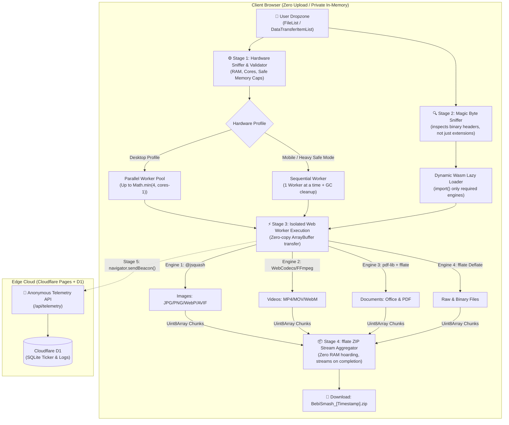

# BebiSmash — System Architecture & Technical Foundation

> **Zero-Upload Client-Side Architecture & Edge Telemetry**  
> Every byte of user data stays strictly inside the client browser's local memory space. Only anonymous, high-level mathematical metadata touches the edge cloud.

---

## 1. System Architecture & The Execution Pipeline

BebiSmash operates on an ultra-private, zero-upload architecture. Compression runs entirely in-memory using WebAssembly and hardware-accelerated WebCodecs, while a serverless edge backend powers an anonymous global impact ticker.



### The 5-Stage Data Lifecycle

#### Stage 1: Ingestion & Validation (Main Thread)

- **Dropzone Ingestion:** Accepts mixed file drops via standard `FileList` and `DataTransferItemList` APIs.
- **Hardware Sniffer:** Evaluates `navigator.deviceMemory` (with fallback user-agent detection on Safari/iOS) and `navigator.hardwareConcurrency` to automatically assign an execution profile:
  - **Desktop Profile:** Launches up to `Math.min(4, cores - 1)` concurrent Web Workers.
  - **Mobile / Safe Sequential Profile:** Enforces strictly 1 active Web Worker at a time, triggering manual garbage collection (`URL.revokeObjectURL`) between individual files.
- **Smart Warning Cap:** Calculates cumulative queued bytes and checks individual video sizes. If safety thresholds are exceeded (**>300 MB** single file on mobile or **>1.5 GB** total on desktop), a non-blocking confirmation modal prompts the user and locks processing into Sequential Safe Mode to prevent browser tab crashes.

#### Stage 2: MIME-Type Routing & Dynamic Wasm Lazy-Loading

- **Ultra-Light Initial Bundle:** The initial landing page bundle is under **50 KB** (HTML/CSS/JS). Zero compression engines are loaded upfront.
- **Magic Byte Sniffing:** When the user initiates compression (_"SMASH & PACK (.ZIP)"_), the Smart Router inspects the actual magic bytes (file headers) rather than relying on file extensions.
- **Just-In-Time Fetching:** Codec modules are dynamically fetched via dynamic `import()` exclusively for the file types present in the active queue.

#### Stage 3: Isolated Worker Execution (Off-Main-Thread)

- **Zero-Copy Transfer:** Files are transferred as `ArrayBuffer` instances using Transferable Objects into dedicated Web Workers, ensuring the UI thread remains responsive at 60 FPS.
- **Parameter Mapping:** Workers apply precise compression parameters based on the selected Smash Intensity: **Gentle**, **Balanced**, or **Heavy**.

#### Stage 4: Streaming ZIP Aggregation (`fflate`)

- **Streaming Aggregation:** Finished files transfer their compressed `Uint8Array` directly into a master ZIP Stream Worker powered by `fflate`.
- **Zero-RAM Hoarding:** Rather than waiting for the entire batch to finish before zipping, individual files are streamed directly into the archive buffer, and intermediate uncompressed buffers are immediately dereferenced for garbage collection.
- **One-Click Download:** Once the final worker resolves, the browser triggers a single, unified archive download: `BebiSmash_[Timestamp].zip`.

#### Stage 5: Anonymous Telemetry Beacon

- **Batch Analytics:** Upon batch completion, an anonymous metadata record is prepared for each file (`ext`, `category`, `original_bytes`, `compressed_bytes`, `duration_ms`).
- **Non-Blocking Telemetry:** Sent via `navigator.sendBeacon('/api/telemetry', payload)` to update the Cloudflare D1 edge database and increment the global live ticker without interrupting page navigation.

---

## 2. The Core Tech Stack (Scalable & $0 Hosting)

| Layer                       | Technology Choice                                 | Why It Fits BebiSmash                                                                                                                                                                            |
| :-------------------------- | :------------------------------------------------ | :----------------------------------------------------------------------------------------------------------------------------------------------------------------------------------------------- |
| **Frontend Framework**      | **Vite + React (or SolidJS) + TypeScript**        | Native ES module support, zero-hassle Web Worker instantiation (`new Worker(new URL(..., import.meta.url))`), and strict type safety across binary buffers.                                      |
| **Styling & State**         | **Tailwind CSS + Zustand**                        | Zustand manages the high-throughput asynchronous file queue outside React's render lifecycle, ensuring smooth 60 FPS progress updates without render thrashing.                                  |
| **Image Engine**            | **@jsquash (WebAssembly)**                        | Modular, standalone Wasm codecs extracted from Google Squoosh (`@jsquash/jpeg`, `@jsquash/png`, `@jsquash/webp`, `@jsquash/avif`).                                                               |
| **Video & Audio Engine**    | **Mediabunny (WebCodecs) + FFmpeg.wasm Fallback** | Leverages native hardware-accelerated WebCodecs for 10x faster MP4/WebM encoding, gracefully falling back to `FFmpeg.wasm` for unsupported containers.                                           |
| **PDF & Office Engine**     | **pdf-lib + fflate + @jsquash**                   | Unpacks `.docx`, `.pptx`, `.xlsx` archives (which are structured ZIP containers), downsamples and compresses internal media via `@jsquash`, and repacks. Downsamples PDF embedded image streams. |
| **Archiver & General Data** | **fflate**                                        | Lightweight (~8 KB), up to 5x faster than JSZip, with native support for streaming, multi-threaded ZIP packing, and raw Deflate/Gzip compression.                                                |
| **Hosting & Edge Backend**  | **Cloudflare Pages + Functions + Cloudflare D1**  | Generous zero-cost edge tier with unlimited static bandwidth, native HTTP headers support for `SharedArrayBuffer`, and serverless SQLite (D1) for analytics.                                     |

---

## 3. Compression Engine Preset Mapping

The Smart Router translates the three user-facing intensity options into concrete codec parameters across all engines:

| File Category                                         | GENTLE<br>_(Lossless / Max Quality)_                                                                                                  | BALANCED<br>_(Recommended Default)_                                                                                       | HEAVY<br>_(Maximum Smash)_                                                                                                        |
| :---------------------------------------------------- | :------------------------------------------------------------------------------------------------------------------------------------ | :------------------------------------------------------------------------------------------------------------------------ | :-------------------------------------------------------------------------------------------------------------------------------- |
| **Images**<br>`JPG`, `PNG`, `WebP`, `AVIF`            | • Strip EXIF & metadata<br>• Oxipng lossless level 3<br>• MozJPEG Q:90 (no chroma subsampling)                                        | • MozJPEG / WebP Q:75<br>• PNG quantized (256 colors via `imagequant`) + Oxipng<br>• Preserve original dimensions         | • Quality 55 with aggressive quantization tables<br>• Optional dimension cap at 1920px max edge                                   |
| **Videos**<br>`MP4`, `MOV`, `WebM`                    | • Remux & strip metadata tracks<br>• CRF 20 (H.264 / H.265)<br>• Keep native resolution & FPS<br>• AAC 192 kbps                       | • CRF 26 (medium preset)<br>• Cap resolution at 1080p (if 4K source)<br>• AAC 128 kbps                                    | • CRF 32<br>• Downscale to 720p (30 FPS cap)<br>• Mono / Stereo AAC 96 kbps                                                       |
| **Office Docs**<br>`PPTX`, `DOCX`, `XLSX`             | • In-memory unzip<br>• Strip thumbnail cache & XML whitespace<br>• Lossless optimization on `/media/*`<br>• Re-zip at Deflate level 6 | • In-memory unzip<br>• Re-encode all `/media/*` images with Balanced Image pipeline (Q:75)<br>• Re-zip at Deflate level 9 | • In-memory unzip<br>• Compress `/media/*` images at Q:50<br>• Cap internal image widths to 1280px<br>• Re-zip at Deflate level 9 |
| **PDF Documents**<br>`PDF`                            | • Remove unused objects & redundant metadata<br>• Deduplicate embedded font subsets<br>• Lossless stream re-compression               | • Downsample embedded raster images to 150 DPI<br>• Re-compress raster images at JPEG Q:75                                | • Downsample embedded raster images to 96 DPI<br>• Re-compress raster images at JPEG Q:55                                         |
| **Raw / Code / Other**<br>`TXT`, `CSV`, `JSON`, `EXE` | • Deflate level 4 inside master ZIP bundle                                                                                            | • Deflate level 6<br>• Optional whitespace minification for JSON / SVG                                                    | • Maximum Deflate level 9 (large memory dictionary)                                                                               |

---

## 4. Database Schema & Edge Telemetry API

Built on **Cloudflare D1 (Serverless SQLite)**. Designed for maximum efficiency: table 1 stores detailed event logs for format analytics, while table 2 acts as a single-row materialized rollup to power the homepage ticker in a single row read.

```sql
-- Table 1: Raw anonymous compression events (for telemetry and format analytics)
CREATE TABLE compression_logs (
    id INTEGER PRIMARY KEY AUTOINCREMENT,
    file_ext TEXT NOT NULL,          -- e.g., 'mp4', 'png', 'pptx'
    category TEXT NOT NULL,          -- 'image', 'video', 'document', 'archive'
    intensity TEXT NOT NULL,         -- 'gentle', 'balanced', 'heavy'
    original_bytes INTEGER NOT NULL,
    compressed_bytes INTEGER NOT NULL,
    saved_bytes INTEGER NOT NULL,
    duration_ms INTEGER NOT NULL,
    device_tier TEXT NOT NULL,       -- 'desktop' or 'mobile'
    created_at DATETIME DEFAULT CURRENT_TIMESTAMP
);

-- Table 2: Fast global ticker rollup (Single row read on initial page load)
CREATE TABLE global_stats (
    id INTEGER PRIMARY KEY CHECK (id = 1),
    total_files_smashed INTEGER DEFAULT 0,
    total_bytes_original INTEGER DEFAULT 0,
    total_bytes_saved INTEGER DEFAULT 0,
    updated_at DATETIME DEFAULT CURRENT_TIMESTAMP
);

-- Seed initial counter
INSERT INTO global_stats (id, total_files_smashed, total_bytes_original, total_bytes_saved)
VALUES (1, 0, 0, 0);
```

---

## 5. Project Folder Structure

A modular, production-ready directory layout separating worker threads, core engines, and UI components:

```text
bebismash/
├── public/
│   ├── _headers                  # CRITICAL: Sets COOP & COEP headers for SharedArrayBuffer (Wasm threads)
│   └── wasm/                     # Cached static Wasm binaries (loaded on-demand)
├── functions/                    # Cloudflare Pages Serverless Edge Functions
│   └── api/
│       └── telemetry.ts          # GET (fetch global ticker) & POST (log batch compression stats)
├── src/
│   ├── components/
│   │   ├── SmashChamber.tsx      # Left 60%: Universal Dropzone & File Sniffer
│   │   ├── ControlDeck.tsx       # Right 40%: Intensity Selector & Queue Container
│   │   ├── FileRow.tsx           # Collapsible queue item (hides nerd telemetry by default)
│   │   ├── WarningModal.tsx      # Smart Warning Cap prompt for heavy mobile/desktop loads
│   │   └── TelemetryBadge.tsx    # Footer Global Ticker + "[?] What We Save" transparency modal
│   ├── core/
│   │   ├── router.ts             # Inspects magic bytes & assigns file to correct worker pool
│   │   ├── hardware.ts           # Detects RAM/CPU cores & enforces Desktop vs. Mobile Safe Mode
│   │   ├── presets.ts            # Maps Gentle / Balanced / Heavy to codec-specific flags
│   │   └── zipBundler.ts         # Streams finished worker buffers into a single BebiSmash.zip
│   ├── workers/
│   │   ├── image.worker.ts       # @jsquash Wasm pipeline (JPEG, PNG, WebP, AVIF)
│   │   ├── video.worker.ts       # WebCodecs / FFmpeg.wasm pipeline
│   │   ├── officePdf.worker.ts   # PPTX/DOCX media extractor + PDF image downsampler
│   │   └── generic.worker.ts     # fflate high-compression binary packer
│   ├── store/
│   │   └── useSmashStore.ts      # Zustand state (staged files, active intensity, progress, stats)
│   ├── App.tsx
│   └── main.tsx
├── wrangler.toml                 # Cloudflare D1 database binding configuration
├── vite.config.ts                # Configured for Web Workers & Wasm asset handling
└── package.json
```

---

## 6. Critical Configuration: Cross-Origin Isolation (`_headers`)

> [!IMPORTANT]
> To unlock multi-threaded WebAssembly and `SharedArrayBuffer` (required for video processing and parallel image batches) without security restrictions, Cloudflare Pages must serve these headers:

File: `public/_headers`

```http
/*
  Cross-Origin-Opener-Policy: same-origin
  Cross-Origin-Embedder-Policy: require-corp
```

---

## 7. Phased Build Roadmap

BebiSmash is developed and tested across four distinct vertical slices to ensure isolation and stability:

```mermaid
gantt
    title BebiSmash Delivery Milestones
    dateFormat  X
    axisFormat  M%d
    section Core
    M1: Core Shell, Router & ZIP Bundler :active, m1, 0, 1
    section Media
    M2: Image & Office Pipeline (@jsquash + fflate) :m2, 1, 2
    M3: PDF & Video Engine (WebCodecs / FFmpeg) :m3, 2, 3
    section Edge
    M4: D1 Telemetry API & Transparency UI :m4, 3, 4
```

### Milestone 1: The Core Shell, Smart Router & ZIP Bundler

- [ ] Initialize Vite + React (or SolidJS) + TypeScript repository.
- [ ] Implement hardware detection (`navigator.deviceMemory`, `navigator.hardwareConcurrency`) and Desktop/Mobile safe limits.
- [ ] Build Zustand state container (`useSmashStore`) managing drag-and-drop file queues and live progress.
- [ ] Implement `fflate` streaming ZIP aggregation worker to output `BebiSmash_[Timestamp].zip`.

### Milestone 2: Image & Office Engine (`@jsquash` + `fflate`)

- [ ] Integrate modular `@jsquash` WebAssembly codecs for JPEG, PNG, WebP, and AVIF.
- [ ] Wire up preset configurations (Gentle, Balanced, Heavy) with `imagequant` color reduction and `oxipng`.
- [ ] Build `.pptx`, `.docx`, and `.xlsx` media extractor: decompress archives in memory, compress embedded `/media/*` images, and repackage at high Deflate levels.

### Milestone 3: PDF & Video Engine (`pdf-lib` + WebCodecs / `FFmpeg.wasm`)

- [ ] Implement hardware-accelerated video compression via WebCodecs API with fallback to `FFmpeg.wasm`.
- [ ] Configure resolution caps (1080p / 720p) and adaptive bitrate targets based on preset.
- [ ] Implement `pdf-lib` stream extraction and raster image downsampling (150 DPI / 96 DPI).
- [ ] Verify sequential execution locks and memory cleanup on mobile viewports.

### Milestone 4: D1 Telemetry API & Transparency Modal

- [ ] Configure Cloudflare Pages Functions (`/api/telemetry`) with Cloudflare D1 SQLite bindings.
- [ ] Deploy `compression_logs` and `global_stats` schema migrations.
- [ ] Implement non-blocking `navigator.sendBeacon()` submission upon batch download.
- [ ] Build footer ticker UI and the _"[?] What We Save"_ transparency modal detailing zero-upload privacy guarantees.
